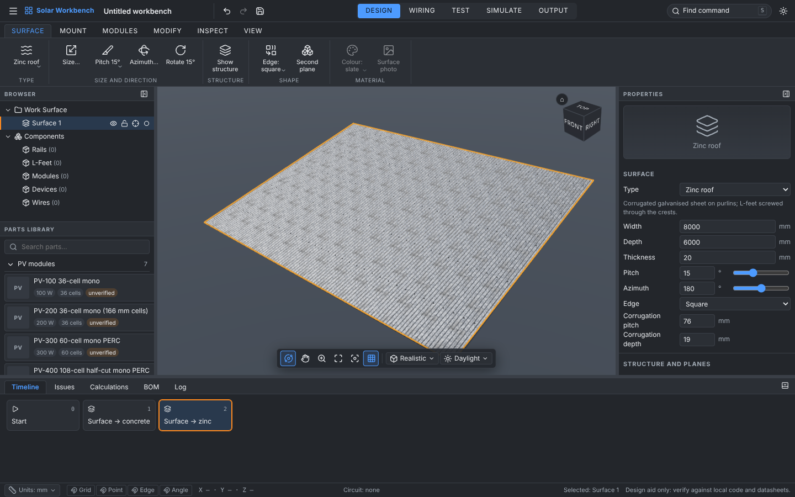
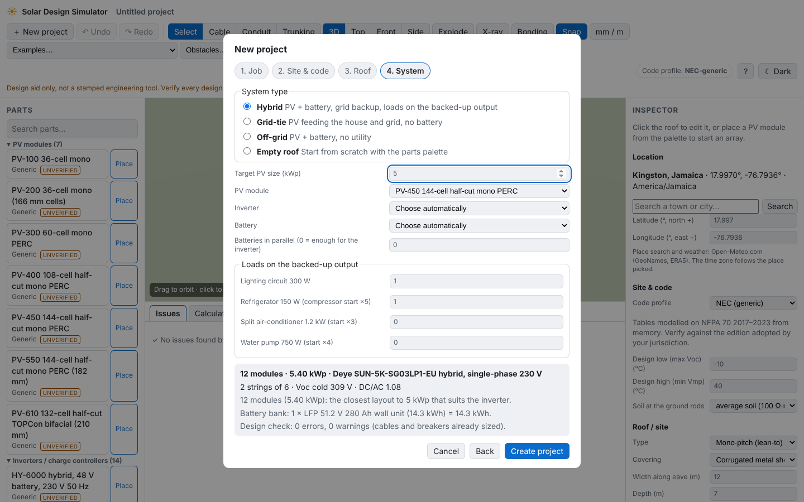
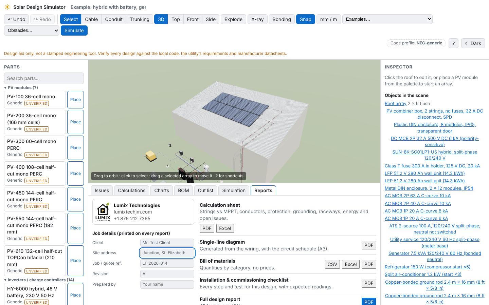

# Solar Design Simulator

A browser-based, fully 3D solar PV and electrical design aid: build a system by
dragging parts into a scene, wire it, and get real electrical calculations,
code-style checks, a single-line diagram and a bill of materials.

> **Design aid only.** Not a stamped engineering tool. Verify every design
> against the local code, the utility's requirements and manufacturer
> datasheets. Bundled catalog data is generic placeholder data marked
> _unverified_.

**Status: Solar Workbench (brief v2), Phase 8: your own wire colours, part sizes in any unit, L-foot spacing, rail alignment. Four phases left (simulation, realism, outputs, desktop app).** See `PLAN.md` for the phases.
**Try it:** [open the Workbench](https://claude.ai/artifact/Mq3cHUnemWbCNTJPjsaDfA) (private claude.ai link, updated after each phase; rebuild with `pnpm build:artifact`). The first-generation roof-based designer runs locally at `#/classic` (it is no longer in the preview link).
**Want to change something? Start with [`docs/CHANGE_GUIDE.md`](docs/CHANGE_GUIDE.md).**



## Solar Workbench

An empty **Work Surface** you build on, with a CAD-style interface:

- **Workspaces and ribbon**: DESIGN, WIRING, TEST, SIMULATE, OUTPUT, each with its own ribbon tabs and
  labelled panels. Dropdown buttons (Type ▾, Pitch ▾, Edge ▾, Display ▾), rich tooltips with the shortcut,
  and every planned button is visible, disabled, and says which phase brings it.
- **Work Surface**, eight types: plain workplane, concrete slab (formwork lines, tie holes, drains), zinc roof
  (real corrugated geometry, spangle texture, screws on the crests), Decromastic (stone-coated tile),
  standing-seam metal, concrete/clay tile, flat membrane with ballast pavers, ground mount with a pad. Size up
  to 30 × 30 m, pitch 0–45°, azimuth, thickness, edge style, a second plane (gable or fold) and a **Show
  structure** toggle (purlins, battens, rafters, anchor grids). Each type carries a data-driven, unverified
  **attachment rule set** shown in Properties.
- **Browser tree** with eye, lock, isolate, rename, colour tags and drag to reorder; **Parts Library** with
  categories, search and cards with real rendered thumbnails; **Properties** with a rotating 3D preview and the data label.
- **Placing parts (Phase 2)**: drag a card onto the surface (or double-click it, or press _Place on surface_): a ghost
  follows the cursor, green when allowed and red with the reason when not, valid attachment points glow, and live
  distances to the edges and neighbours show as you move. L-foot, slotted foot, tile hook, standoff, seam clamp, base
  plate with anchors, ballast and ground screw snap onto purlins, battens, seams and anchor grids per surface type;
  _Free placement_ turns the rules off. **Tab** types exact distances (`600+25`, `0.75m`, `2'6"`), **Shift** keeps
  placing, **R** rotates, **Alt** turns snapping off. Tilt legs follow one tilt angle (leg cut lengths live in
  Properties and the BOM). DIN devices snap into the slots of an enclosure's rail.
- **Measure and line up (Phase 8)**: pick any wire colour (swatches or your own); select a part to see its size in
  Properties and as dimension lines, with a unit picker (mm, cm, m, in, ft, ft-in) right there; place a row of L-feet
  at a typed distance ("4 feet, 48in apart"), edit one gap or re-space the whole row; line rails up from a rail's
  Alignment panel (start from the edge, start/end against the other rails, Line up).
- **Wiring (Phase 7)**: **W** starts the Wire tool: terminals show as coloured dots on every part (inverters,
  batteries, breakers inside boxes, modules); click one and then the one it goes to, or pick both by name.
  Reversed polarity and AC-to-DC are refused with the reason. **Trunking** (4 × 4 in by default) and **conduit** are
  drawn by clicking corners on a wall or roof; pull wires through a run and see its fill, the mitre cut list and
  the lengths to buy. Wires are bought by the metre in the BOM; deleting a part takes its wires.
- **CAD look and ease of use (Phase 6)**: Inter font, coloured tool icons per toolbar group, a CAD studio backdrop;
  **press and drag** any placed part (feet, boxes, inverters, rails, modules) to move it, with black Fusion-style
  dimensions, release to drop (Ctrl copies, Alt fine steps, Esc cancels); the **view cube** spins the model when
  dragged and has corner/edge hot spots and 90° turn arrows; new projects start on a 12 × 8 m plate; rails come in
  14/16/18/20/24 ft sticks; modules from 450 to 720 W are picked by wattage.
- **Boxes and brands (Phase 5)**: Deye, Growatt, Luxpower, SRNE and Sol-Ark inverters with datasheet links and a
  brand filter in the library; HT DIN boxes from 4 to 18 way; **ready-made boxes** placed in one step (PV combiner
  2-in 2-out with DC breakers and SPDs, battery disconnect, manual changeover, ATS with voltage protector, AC
  distribution board, hybrid inverter board). **Double-click a box** (or INSERT ▾ Open cover) to swing the door open
  and lift the inner cover off; click a breaker inside to select it. **Shift+F** zooms onto the selection.
- **Fusion 360-style (Phase 4)**: the BUILD tab has CREATE ▾, MODIFY ▾, ASSEMBLE ▾, CONSTRUCT ▾, INSPECT ▾, INSERT ▾,
  SELECT ▾ groups; Fusion shortcuts (M Move/Copy, I Measure, V show/hide, J Clamp all, S command box, Ctrl+C/V,
  Ctrl+A, Delete, F6 fit, Home) and navigation (middle-drag pan, Shift+middle orbit, wheel zoom, right-click
  marking menu). Shift/Ctrl+click selects several parts; **Move/Copy** with drag arrows or typed distances,
  **Rectangular pattern** by dragging an arrow (a copy appears at every spacing), **Mirror** across the centre or a
  guide, copy/paste; each is one timeline card. **Origin** (X/Y/Z axes, XY/XZ/YZ planes) and **Surface on plane**
  build roofs, slabs, ground or block/wood **walls**; inverters, batteries and boxes hang on walls.
- **Rails, cut, splice, clamps, modules (Phase 3)**: rails seat in the slot of a row of feet (stock 2.1 / 3.6 / 4.2 m,
  three profiles) with live overhangs; **Cut** at a typed length from either end (3 mm kerf), the cut-off goes to the
  **offcut pool** and can be reused ("Use offcut"); **Splice** checks the rails are in line and offers Auto-align, and
  turns them into one rail run; modules snap onto two rails inside their clamping zones, and **Array** places rows ×
  columns with the 20 mm mid-clamp gap; **Clamp all** (or Join / Add) puts end and mid clamps on every crossing in one
  click. The **Issues** tab checks attachments, spans, overhangs, splice support, rails and clamps per module; the
  **BOM** counts stock rails bought and the waste. **Pattern** repeats a foot in rows × columns. Everything is in
  the timeline and can be rolled back.
- **Precision**: rulers along the surface edges, guide lines (drag from a ruler or type), snap toggles in the status
  bar (grid, point, edge, guide, angle), a Measure tool (D), live BOM with fasteners counted.
- **Custom parts**: _My parts → Add custom part_ turns a product photo into a library card and a 3D part (DIN breaker,
  DIN enclosure, transfer switch): straighten, crop, remove background, calibrate the scale, enter ratings, mark
  terminals. Export/import `.partpack`, or drop a folder in `assets/user-parts/` (see its README).
- **Timeline**: every action is a command card; click one to roll back. History is event-sourced and saved
  with the file (`.solarbench.json`) and in the browser's autosave.
- **View cube**, navigation bar (orbit, pan, zoom, fit, look at), display modes (Realistic, Shaded with edges,
  Wireframe, X-ray, Exploded), environments (Studio, Daylight, Overcast, Sunset), section plane with an
  in-canvas options bar (OK / Cancel).
- **Command search (S)**, **marking menu** (right-click or M), shortcut cheat sheet (?), resizable and
  collapsible panels remembered between visits, dark and light themes, mm / cm / m / in / ft-in with typed
  units (`10ft`, `0.75m`).
- Accessibility: axe-core (WCAG 2.1 AA) runs in the test suite on every workspace, menu and dialog, in both themes.

## First-generation designer (v1, `#/classic`)



Phase 8 adds:

- **New project wizard** (toolbar **＋ New project**): job and client → site and
  code profile → roof → system. Pick grid-tie, hybrid or off-grid, a target kWp
  and a module (inverter and battery automatically or by choice, loads for the
  backed-up output). The auto-designer then:
  - chooses the inverter and string layout with the String Wizard;
  - lays the array out on the best-facing roof surface;
  - places the inverter, combiner or DC isolators where needed, the battery
    bank with its Class T fuse, an AC panel with breakers, the utility, loads,
    two bonded ground rods, the EGCs and the GEC;
  - runs the design rules and upsizes every conductor or breaker they flag
    until the design is clean.

  "Empty roof" starts from scratch.

- **Examples**: grid-tie house (5 kWp) and off-grid cabin (3 kWp), both built
  by the same auto-designer, next to the hybrid example.
- **Offline / install**: production builds are installable web apps (manifest
  and service worker); after one visit the app opens and works without a
  network (real weather excepted).
- **Speed**: the chart tabs load on demand, which cuts the start-up bundle from
  1.4 MB to 0.5 MB. A 132-module design is re-checked in about 15 ms, and a test
  guards this.
- **Accessibility**: an axe-core audit (WCAG 2.1 AA) runs in the e2e suite on
  every tab, the wizard and dark mode. Contrast and keyboard issues it found
  are fixed.
- **Hosting**: `netlify.toml`, `vercel.json` and a manual GitHub Pages workflow
  (see [`docs/DEPLOY.md`](docs/DEPLOY.md)).



Phase 7 adds the **Reports** tab and Lumix Technologies branding (logo and
contact details on every page, from `config/company.ts`). Enter the client, site
address, job reference, revision and preparer once; then export:

- **Calculation sheet** (PDF or Excel): basis of design, arrays and inverters,
  strings against each MPPT window (Voc cold, Vmp hot), every conductor
  (design current, allowable ampacity, conductors in raceway, voltage drop),
  every breaker / fuse / isolator, grounding electrode and bonding, raceway
  fill and bends, energy results when the simulation is current, open issues.
- **Single-line diagram** (PDF, A3): generated from the wiring with device
  designators (S1, CMB1, CB1, F1, INV1, BAT1, ATS1, UT1, GEN1, LD1…), DC and AC
  circuits, conductor labels like "(2) #10 PV", raceways and EGC sizes, plus the
  circuit schedule. A live preview sits in the Reports tab.
- **Bill of materials** (CSV, Excel or PDF): quantities by category, **no
  prices**. The BOM tab has the same three buttons.
- **Installation and commissioning checklist** (PDF): steps named for this
  design's own strings and devices, with expected readings (Voc, Isc,
  insulation resistance, electrode resistance, ATS transfer times) and blanks
  for measured values and initials.
- **Full design report**: all four in one PDF.

Phase 6 adds the **Simulation** tab (toolbar **Simulate**): real hourly weather
for any place in the world from Open-Meteo (ERA5 reanalysis; default Kingston,
Jamaica; pick a town in Site & code), or an offline clear-sky estimate. It
simulates a day, month or year in 5/15/60-minute steps: sun position,
Hay–Davies plane-of-array irradiance, shading from **trees, water tanks and
neighbouring buildings** (toolbar **Obstacles**) and from the house and other
arrays, bypass diodes, cell temperature, MPPT, wiring losses, inverter
efficiency, battery state of charge with BMS limits, grid import/export, daily
outages and the generator through the ATS. Results: totals, peak sun hours per
day and month, power and SoC charts, a loss waterfall, and a time slider that
moves the sun and the shadows and colours every cable by its current. A one-day
case is checked against an independent LibreOffice spreadsheet
(`docs/verification/day-check/`). Each load gets a daily-use profile in its
inspector.

Phase 5 adds the **Conduit** (U) and **Trunking** (T) tools: click points on the
ground, walls, roof or equipment (height changes add a riser), Enter to finish.
Conduit: PVC Schedule 40/80 (½–6 in), FMC and LFMC (⅜–4 in), LFNC-B (⅜–2 in)
with real internal areas; trunking: PVC trunking and steel wireway in inch
sizes. The inspector shows the live fill gauge with a cross-section of the
packed conductors (53/31/40 %, 20 % for trunking), bends between pull points
(360° max; tick a corner as an LB / pull box), bend radius against the
trade-size minimum, location suitability (wet, sun, burial, damage), PVC
expansion, sticks, elbows and straps. Trunking corners are mitred at half the
turn with the cut drawn in 3D. Cables are pulled through raceways from either
inspector; their routed length feeds voltage drop and the conductors sharing a
raceway feed the ampacity adjustment. A **Cut list** tab lists rail cuts,
conduit bends and trunking mitres; the BOM counts conduit, fittings and
trunking.

Phase 4 adds combiner boxes, DIN-rail breakers, fuses, isolators and SPDs that
snap into enclosures, Class T / MRBF battery fuses, transfer switches (2–3
sources, nested, outage scenarios), utility and generator sources, loads, ground
rods, ground bars, lay-in lugs and WEEBs. Rules check each protective device
(AC/DC rating, voltage, interrupting rating against the available fault current,
conductor protection), combiner fusing, battery fault current and the battery
fuse, inverter capacity against connected loads, EGC/GEC size, ground-rod
resistance (soil type) and that every metal part is bonded. Toolbar: **Examples →
Hybrid** loads a complete PV + battery + generator + ATS system; **X-ray**
shows inside panels; **Bonding** colours bonded metal green and floating metal
red; **Frame (F)** zooms to the selected part. Module + leads are male MC4, −
leads female.

Phase 3 adds inverters (Deye, Growatt, Luxpower, SRNE, Sol-Ark; single-, split- and
three-phase; unverified specs), batteries, PV wire and MC4 connectors, strings
(auto-string and String Wizard), a Cable tool, cold-weather Voc / hot-weather Vmp
checks against each MPPT, polarity, MC4 mating and mixed-brand checks, cable
ampacity and voltage drop, the MPPT operating point solved with the wiring, and a
Jamaica code-profile preset.

Phase 2 lets you edit the roof (mono-pitch, gable, flat slab, ground; corrugated,
standing-seam, tile, shingle, concrete), place PV arrays with the array tool
(click "Place" or drag a module onto the roof), and get every rail, splice,
clamp, L-foot or tilt leg laid out automatically with a cut list, mechanical
checks, a BOM, undo/redo and browser autosave.

The engine (`packages/engine`) currently provides: sun position (NOAA), the
De Soto single-diode PV model with I–V/P–V curves, cell temperature (NOCT and
Faiman), a linear quick model, conductor resistance (NEC Table 8 / IEC 60228)
with temperature correction, voltage drop (DC, 1-phase, split-phase,
3-phase), NEC ampacity with ambient, bundling, rooftop and terminal limits,
conductor sizing with the working shown, and a DC circuit solver (MNA with
Newton–Raphson for PV sources).

## Quick start

```bash
pnpm install
pnpm dev
```

Then open http://localhost:5173. Other commands are in `CLAUDE.md`.

## Repository layout

| Path               | What                                                        |
| ------------------ | ----------------------------------------------------------- |
| `packages/engine`  | Pure TypeScript physics and design rules (no DOM/three)     |
| `packages/catalog` | Parts database: Zod schemas, JSON data, loader              |
| `apps/web`         | React + three.js app                                        |
| `tools/blender`    | Headless Blender scripts that generate part models (`.glb`) |

## How to add a part to the catalog

(Short version below; the full set of recipes is in `docs/CHANGE_GUIDE.md`.)

1. Pick the file in `packages/catalog/src/data/` for the category (or add one
   and include it in `data/index.ts`).
2. Add an entry that matches the schema in `packages/catalog/src/schema/`.
   Units are in the field name (`vocV`, `weightKg`, `dimensions.lengthMm`).
   Port positions are in metres in the part's local frame.
3. Leave `"verified": false` unless you checked every number on the datasheet.
4. Optional: add a Blender script in `tools/blender/parts/`, run
   `pnpm models <name>`, and set `"modelUrl"` on the entry.
5. Run `pnpm test`: the catalog test rejects invalid or duplicate entries.

## How to add a code profile

Code profiles arrive in Phase 1 (`packages/engine/src/profiles/`). This section
will be filled in then.
