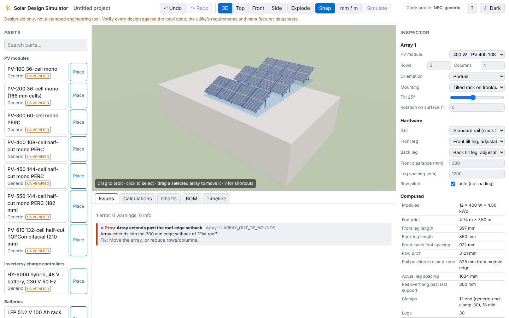

# Solar Design Simulator

A browser-based, fully 3D solar PV and electrical design aid: build a system by
dragging parts into a scene, wire it, and get real electrical calculations,
code-style checks, a single-line diagram and a bill of materials.

> **Design aid only.** Not a stamped engineering tool. Verify every design
> against the local code, the utility's requirements and manufacturer
> datasheets. Bundled catalog data is generic placeholder data marked
> _unverified_.

**Status: Phase 2 (roof, panels and mounting hardware in 3D).** See `PLAN.md` for the roadmap.
**Want to change something? Start with [`docs/CHANGE_GUIDE.md`](docs/CHANGE_GUIDE.md).**



Phase 2 lets you edit the roof (mono-pitch, gable, flat slab, ground; corrugated,
standing-seam, tile, shingle, concrete), place PV arrays with the array tool
(click "Place" or drag a module onto the roof), and get every rail, splice,
clamp, L-foot or tilt leg laid out automatically with a cut list, mechanical
checks, a BOM with placeholder prices, undo/redo and browser autosave.

The engine (`packages/engine`) currently provides: sun position (NOAA), the
De Soto single-diode PV model with I–V/P–V curves, cell temperature (NOCT and
Faiman), a linear quick model, conductor resistance (NEC Table 8 / IEC 60228)
with temperature correction, voltage drop (DC, 1-phase, split-phase,
3-phase), NEC ampacity with ambient, bundling, rooftop and terminal limits,
conductor sizing with the working shown, and a DC circuit solver (MNA with
Newton–Raphson for PV sources).

## Quick start

```bash
pnpm install
pnpm dev
```

Then open http://localhost:5173. Other commands are in `CLAUDE.md`.

## Repository layout

| Path               | What                                                        |
| ------------------ | ----------------------------------------------------------- |
| `packages/engine`  | Pure TypeScript physics and design rules (no DOM/three)     |
| `packages/catalog` | Parts database: Zod schemas, JSON data, loader              |
| `apps/web`         | React + three.js app                                        |
| `tools/blender`    | Headless Blender scripts that generate part models (`.glb`) |

## How to add a part to the catalog

(Short version below; the full set of recipes is in `docs/CHANGE_GUIDE.md`.)

1. Pick the file in `packages/catalog/src/data/` for the category (or add one
   and include it in `data/index.ts`).
2. Add an entry that matches the schema in `packages/catalog/src/schema/`.
   Units are in the field name (`vocV`, `weightKg`, `dimensions.lengthMm`).
   Port positions are in metres in the part's local frame.
3. Leave `"verified": false` unless you checked every number on the datasheet.
4. Optional: add a Blender script in `tools/blender/parts/`, run
   `pnpm models <name>`, and set `"modelUrl"` on the entry.
5. Run `pnpm test`: the catalog test rejects invalid or duplicate entries.

## How to add a code profile

Code profiles arrive in Phase 1 (`packages/engine/src/profiles/`). This section
will be filled in then.
