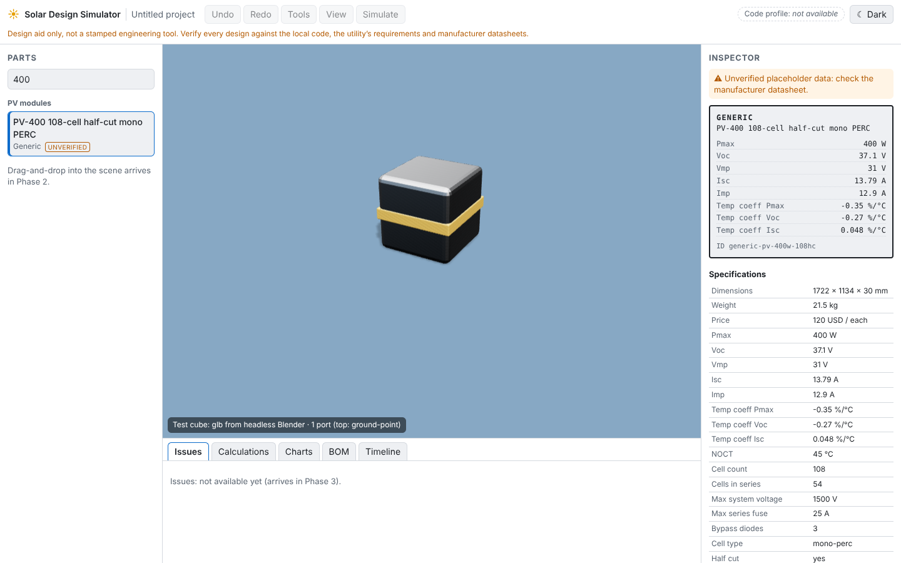

# Solar Design Simulator

A browser-based, fully 3D solar PV and electrical design aid: build a system by
dragging parts into a scene, wire it, and get real electrical calculations,
code-style checks, a single-line diagram and a bill of materials.

> **Design aid only.** Not a stamped engineering tool. Verify every design
> against the local code, the utility's requirements and manufacturer
> datasheets. Bundled catalog data is generic placeholder data marked
> _unverified_.

**Status: Phase 0 (foundation).** See `PLAN.md` for the roadmap.



## Quick start

```bash
pnpm install
pnpm dev
```

Then open http://localhost:5173. Other commands are in `CLAUDE.md`.

## Repository layout

| Path               | What                                                        |
| ------------------ | ----------------------------------------------------------- |
| `packages/engine`  | Pure TypeScript physics and design rules (no DOM/three)     |
| `packages/catalog` | Parts database: Zod schemas, JSON data, loader              |
| `apps/web`         | React + three.js app                                        |
| `tools/blender`    | Headless Blender scripts that generate part models (`.glb`) |

## How to add a part to the catalog

1. Pick the file in `packages/catalog/src/data/` for the category (or add one
   and include it in `data/index.ts`).
2. Add an entry that matches the schema in `packages/catalog/src/schema/`.
   Units are in the field name (`vocV`, `weightKg`, `dimensions.lengthMm`).
   Port positions are in metres in the part's local frame.
3. Leave `"verified": false` unless you checked every number on the datasheet.
4. Optional: add a Blender script in `tools/blender/parts/`, run
   `pnpm models <name>`, and set `"modelUrl"` on the entry.
5. Run `pnpm test`: the catalog test rejects invalid or duplicate entries.

## How to add a code profile

Code profiles arrive in Phase 1 (`packages/engine/src/profiles/`). This section
will be filled in then.
