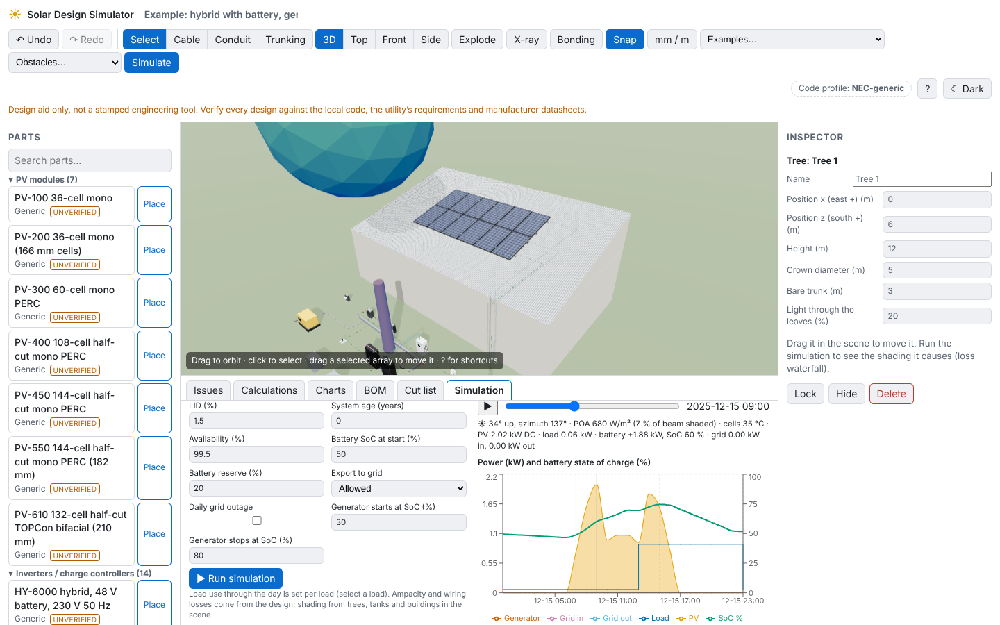

# Solar Design Simulator

A browser-based, fully 3D solar PV and electrical design aid: build a system by
dragging parts into a scene, wire it, and get real electrical calculations,
code-style checks, a single-line diagram and a bill of materials.

> **Design aid only.** Not a stamped engineering tool. Verify every design
> against the local code, the utility's requirements and manufacturer
> datasheets. Bundled catalog data is generic placeholder data marked
> _unverified_.

**Status: Phase 6 (energy simulation with real weather, shading, battery, grid and generator).** See `PLAN.md` for the roadmap.
**Want to change something? Start with [`docs/CHANGE_GUIDE.md`](docs/CHANGE_GUIDE.md).**



Phase 6 adds the **Simulation** tab (toolbar **Simulate**): real hourly weather
for any place in the world from Open-Meteo (ERA5 reanalysis; default Kingston,
Jamaica; pick a town in Site & code), or an offline clear-sky estimate. It
simulates a day, month or year in 5/15/60-minute steps: sun position,
Hay–Davies plane-of-array irradiance, shading from **trees, water tanks and
neighbouring buildings** (toolbar **Obstacles**) and from the house and other
arrays, bypass diodes, cell temperature, MPPT, wiring losses, inverter
efficiency, battery state of charge with BMS limits, grid import/export, daily
outages and the generator through the ATS. Results: totals, peak sun hours per
day and month, power and SoC charts, a loss waterfall, and a time slider that
moves the sun and the shadows and colours every cable by its current. A one-day
case is checked against an independent LibreOffice spreadsheet
(`docs/verification/day-check/`). Each load gets a daily-use profile in its
inspector.

Phase 5 adds the **Conduit** (U) and **Trunking** (T) tools: click points on the
ground, walls, roof or equipment (height changes add a riser), Enter to finish.
Conduit: PVC Schedule 40/80 (½–6 in), FMC and LFMC (⅜–4 in), LFNC-B (⅜–2 in)
with real internal areas; trunking: PVC trunking and steel wireway in inch
sizes. The inspector shows the live fill gauge with a cross-section of the
packed conductors (53/31/40 %, 20 % for trunking), bends between pull points
(360° max; tick a corner as an LB / pull box), bend radius against the
trade-size minimum, location suitability (wet, sun, burial, damage), PVC
expansion, sticks, elbows and straps. Trunking corners are mitred at half the
turn with the cut drawn in 3D. Cables are pulled through raceways from either
inspector; their routed length feeds voltage drop and the conductors sharing a
raceway feed the ampacity adjustment. A **Cut list** tab lists rail cuts,
conduit bends and trunking mitres; the BOM counts conduit, fittings and
trunking.

Phase 4 adds combiner boxes, DIN-rail breakers, fuses, isolators and SPDs that
snap into enclosures, Class T / MRBF battery fuses, transfer switches (2–3
sources, nested, outage scenarios), utility and generator sources, loads, ground
rods, ground bars, lay-in lugs and WEEBs. Rules check each protective device
(AC/DC rating, voltage, interrupting rating against the available fault current,
conductor protection), combiner fusing, battery fault current and the battery
fuse, inverter capacity against connected loads, EGC/GEC size, ground-rod
resistance (soil type) and that every metal part is bonded. Toolbar: **Examples →
Hybrid** loads a complete PV + battery + generator + ATS system; **X-ray**
shows inside panels; **Bonding** colours bonded metal green and floating metal
red; **Frame (F)** zooms to the selected part. Module + leads are male MC4, −
leads female.

Phase 3 adds inverters (Deye, Growatt, Luxpower, SRNE, Sol-Ark; single-, split- and
three-phase; unverified specs), batteries, PV wire and MC4 connectors, strings
(auto-string and String Wizard), a Cable tool, cold-weather Voc / hot-weather Vmp
checks against each MPPT, polarity, MC4 mating and mixed-brand checks, cable
ampacity and voltage drop, the MPPT operating point solved with the wiring, and a
Jamaica code-profile preset.

Phase 2 lets you edit the roof (mono-pitch, gable, flat slab, ground; corrugated,
standing-seam, tile, shingle, concrete), place PV arrays with the array tool
(click "Place" or drag a module onto the roof), and get every rail, splice,
clamp, L-foot or tilt leg laid out automatically with a cut list, mechanical
checks, a BOM with placeholder prices, undo/redo and browser autosave.

The engine (`packages/engine`) currently provides: sun position (NOAA), the
De Soto single-diode PV model with I–V/P–V curves, cell temperature (NOCT and
Faiman), a linear quick model, conductor resistance (NEC Table 8 / IEC 60228)
with temperature correction, voltage drop (DC, 1-phase, split-phase,
3-phase), NEC ampacity with ambient, bundling, rooftop and terminal limits,
conductor sizing with the working shown, and a DC circuit solver (MNA with
Newton–Raphson for PV sources).

## Quick start

```bash
pnpm install
pnpm dev
```

Then open http://localhost:5173. Other commands are in `CLAUDE.md`.

## Repository layout

| Path               | What                                                        |
| ------------------ | ----------------------------------------------------------- |
| `packages/engine`  | Pure TypeScript physics and design rules (no DOM/three)     |
| `packages/catalog` | Parts database: Zod schemas, JSON data, loader              |
| `apps/web`         | React + three.js app                                        |
| `tools/blender`    | Headless Blender scripts that generate part models (`.glb`) |

## How to add a part to the catalog

(Short version below; the full set of recipes is in `docs/CHANGE_GUIDE.md`.)

1. Pick the file in `packages/catalog/src/data/` for the category (or add one
   and include it in `data/index.ts`).
2. Add an entry that matches the schema in `packages/catalog/src/schema/`.
   Units are in the field name (`vocV`, `weightKg`, `dimensions.lengthMm`).
   Port positions are in metres in the part's local frame.
3. Leave `"verified": false` unless you checked every number on the datasheet.
4. Optional: add a Blender script in `tools/blender/parts/`, run
   `pnpm models <name>`, and set `"modelUrl"` on the entry.
5. Run `pnpm test`: the catalog test rejects invalid or duplicate entries.

## How to add a code profile

Code profiles arrive in Phase 1 (`packages/engine/src/profiles/`). This section
will be filled in then.
